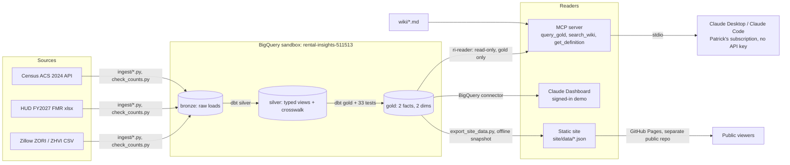

# Architecture

Public housing data (Zillow, HUD, Census) lands in BigQuery, dbt turns it into tested gold tables, and three ways of reading gold sit on top: an MCP server for Claude, a signed-in Claude Dashboard, and a static public site. Each layer reads only the one below it.

## Diagram

Checks on the path: `check_counts.py` (bronze equals source rows), `dbt test` (keys, relationships, accepted values), `dq_report.py --check` (nulls and duplicates per gold table), `check_dictionary.py` (every gold column documented), the SQL guardrail and its tests, the Stop hook and CI (pytest, dbt parse, pack check).

## Decision records

### AR-1: BigQuery sandbox, rebuilt whole by dbt
- **Context:** free tier, no billing account; the sandbox has no DML and tables expire after 60 days.
- **Decision:** dbt builds gold as whole tables (CREATE OR REPLACE), never incremental. Rebuild before the expiry (OI-173, around 2026-12-12).
- **Consequence:** freshness is the table's modified time, which `query_gold` returns as `as_of`. The public site uses an exported snapshot so it outlives the sandbox (D-002).

### AR-2: Medallion layers with tests at each step
- **Context:** four sources with different grains (metro by month, CBSA, county).
- **Decision:** bronze keeps raw rows (counted against the source files), silver types and cleans them and crosswalks Zillow metros to Census CBSAs by name plus a seed of overrides, gold holds two facts and two dimensions with key and relationship tests.
- **Consequence:** 867 of 910 Zillow metros match a CBSA (measured 2026-10-13); unmatched ones stay in dim_metro with a NULL CBSA instead of a guessed match.

### AR-3: Claude reads data through MCP, not an API key
- **Context:** the portfolio must run on Patrick's Claude subscription with no API spend.
- **Decision:** a local MCP server (stdio) that Claude Desktop and Claude Code launch; the client's model writes SQL, the server checks and runs it.
- **Consequence:** no server-side LLM calls, so no model cost inside the project; generation quality depends on the client's model, so the tool descriptions carry the schema and rules.

### AR-4: Two walls around generated SQL
- **Context:** model-written SQL cannot be trusted to be safe (nl-to-sql-safety).
- **Decision:** wall 1 is the identity: `ri-reader` can read gold and nothing else (D-003). Wall 2 is `mcp/guard.py` on the parsed tree: one SELECT, gold tables only, no SELECT *, no unparenthesized AND/OR, no model or external functions, size and nesting limits.
- **Consequence:** a guard bypass still cannot write (live test: CREATE TABLE denied 5 of 5). Responses carry source keys or a refusal (`tools/contract.py`).

### AR-5: Public site is static; dashboard stays signed-in
- **Context:** the Claude Dashboard needs a sign-in to view (D-001).
- **Decision:** the public sees a static site on GitHub Pages from a separate public repo, built from exported gold numbers; the dashboard stays as the signed-in demo (D-002).
- **Consequence:** the public site makes no live queries and needs no credentials; Zillow's terms must be read before it goes public (OI-165; done 2026-10-19: Patrick read them and chose Zillow with credit, portfolio decision D-019).
- **Update (2026-10-13, D-004):** the code is also published, as a cleaned public mirror with fresh history. It runs the MCP server on a DuckDB snapshot of gold (Parquet), so readers need no BigQuery project. The hub moves to a custom domain. These are planned in C3.T5, C3.T6, C7.T4 and C7.T5 and are not built yet.

Project decisions with dates and who made them are in [decisions.md](decisions.md); operating procedures are in [runbooks.md](runbooks.md).
